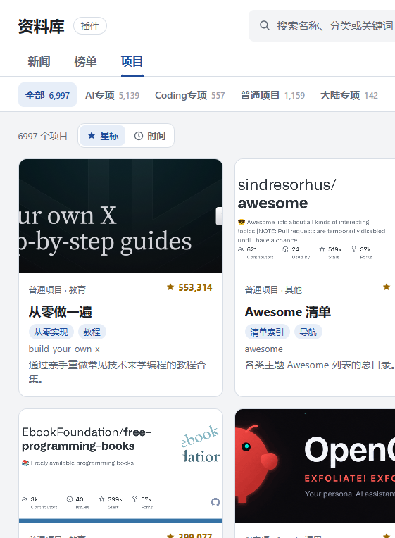
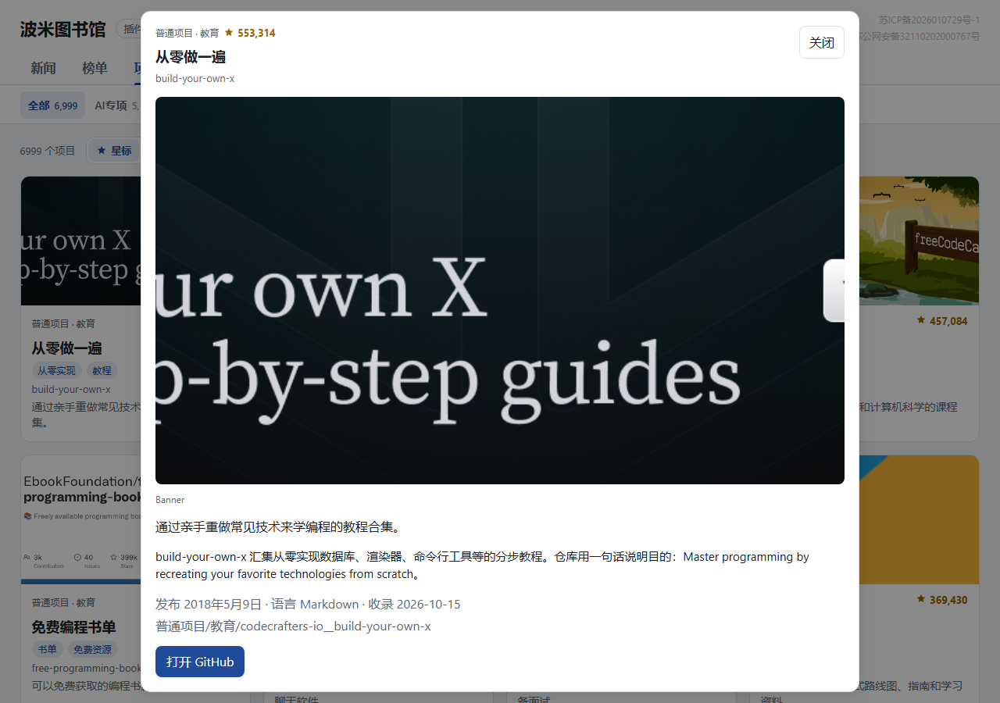
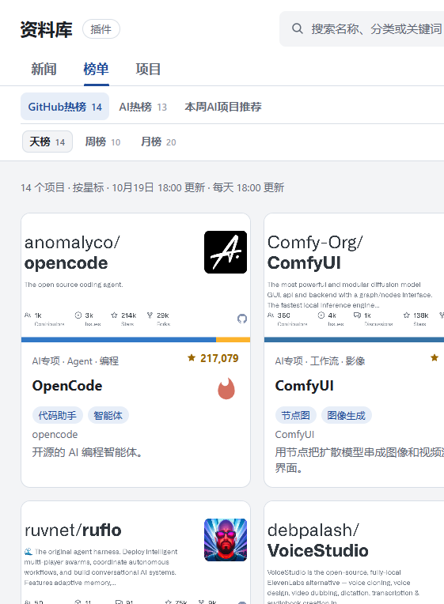
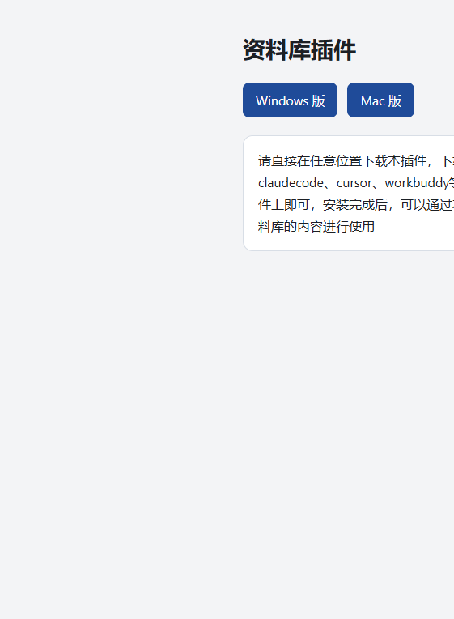

# Pomi Library

中文 | [English](#english)

Pomi Library 是一个公开资料库，收录开源项目、AI 新闻和 GitHub 榜单，网站在 [pomi.me](https://www.pomi.me)。它主要给刚开始用 AI、还不熟代码和 GitHub 的人：搜索、看懂和操作仓库都有门槛，这里用中文分类、摘要和配图把项目摊开，按用途就能找。作者的项目被收录后，也会多一次出现在这些读者面前的机会。这个仓库是它的插件：装进 Codex、Claude Code、Cursor 或 Workbuddy 之后，助手可以在本机查询这些资料。

[](LICENSE)

[Windows 下载](https://github.com/CreateWorld-studio/pomi-library/releases/download/v1.0.0/pomi-windows.zip) · [macOS 下载](https://github.com/CreateWorld-studio/pomi-library/releases/download/v1.0.0/pomi-mac.zip) · [网站](https://www.pomi.me)



## 网站怎么用

用浏览器打开 https://www.pomi.me 。不用注册，也不用安装。页面上方有三个栏目。

### 项目

「项目」里按星标从高到低浏览收录过的仓库。顶上可以按专栏筛选：

- 全部
- AI专项：Agent、skills、工作流、AI功能，下面再按领域分
- Coding专项：按行业，例如游戏、应用、工具、商业
- 普通项目：游戏、商业、编程、写作、设计、教育、音视频、效率工具等
- 大陆专项：和在中国大陆把 AI 换成收入有关的项目

点「星标」按 GitHub 星标排序，点「时间」按更新时间排序。搜索框可以搜中文名、英文名、分类和关键词。

点开一张卡片，能看到配图、中文名、英文名、摘要、更长的介绍、星标、语言，以及「打开 GitHub」。



### 新闻

「新闻」只保留最近 7 天。内容主要是新模型、公司的产品或技术动向、GitHub 上新出现或星标涨得很快的项目，以及少量能对上具体人和日期的轶事。卡片按事情发生的日期从新到旧排，点开可以看摘要和来源。


### 榜单

「榜单」分成 GitHub 热榜和 AI 热榜，各有天榜、周榜、月榜。每天 18:00 更新。还有「本周 AI 项目推荐」。点进一条，看到的还是同一张项目卡。



### 插件下载页

标题旁边的「插件」进入下载页。Windows 和 macOS 各有一个压缩包。



## 插件怎么用

1. 按自己的系统下载压缩包，解压到任意文件夹。
   - [Windows](https://github.com/CreateWorld-studio/pomi-library/releases/download/v1.0.0/pomi-windows.zip)
   - [macOS](https://github.com/CreateWorld-studio/pomi-library/releases/download/v1.0.0/pomi-mac.zip)
2. 复制解压后那个文件夹的完整路径。
3. 打开 Codex、Claude Code、Cursor 或 Workbuddy，新开一个对话。
4. 把路径贴进去，让它把这个插件安装到当前软件。
5. 安装完成后，可以直接让它查看资料库，也可以让它读取资料库里的项目、新闻和榜单来回答问题。

查询前助手会先看本机有没有资料。没有，或者网站上有更新，它会从 https://www.pomi.me 同步文本资料到本机。已有资料时可以先用现成的，同步完成后再用新的。助手不会另外打开网页，也不会自己去抓 GitHub。

可以这样问：

- 帮我在资料库里找本地语音相关的项目
- 今天的 AI 新闻有哪些
- GitHub 日榜前十是什么
- 打开 `anomalyco/opencode` 这条，讲讲它是做什么的

助手实际会运行插件目录里的命令：

```text
python skills/ziliao/ziliao.py status
python skills/ziliao/ziliao.py update
python skills/ziliao/ziliao.py search 关键词 --limit 8
python skills/ziliao/ziliao.py search 关键词 --group AI专项 --limit 5
python skills/ziliao/ziliao.py card owner/name
python skills/ziliao/ziliao.py news --days 7
python skills/ziliao/ziliao.py ranks --board ai --period daily --limit 10
```

`--group` 可以填专栏、二级分类或三级分类。榜单 `--board` 用 `github` 或 `ai`，`--period` 用 `daily`、`weekly` 或 `monthly`。搜索只返回少量结果。资料里没有的内容不会编造。

本机需要有 Python 3，助手在安装和查询时会用到它。只看网站则不需要。

## English

Pomi Library is a public library of open-source projects, AI news, and GitHub rankings. The site is [pomi.me](https://www.pomi.me). It is for people who are new to AI and do not yet know their way around code or GitHub. Searching, reading, and using a repository still takes know-how; the library flattens that with Chinese categories, short summaries, and images, so you can look things up by what you want to do. Projects that are included also get another chance to be seen by those readers. This repository is the plugin: once it is installed in Codex, Claude Code, Cursor, or Workbuddy, the agent can query that library on your machine.

[](LICENSE)

[Download for Windows](https://github.com/CreateWorld-studio/pomi-library/releases/download/v1.0.0/pomi-windows.zip) · [Download for macOS](https://github.com/CreateWorld-studio/pomi-library/releases/download/v1.0.0/pomi-mac.zip) · [Website](https://www.pomi.me)

### Using the website

Open https://www.pomi.me in a browser. No account and no install.

The top of the page has three sections.

**Projects.** Browse repositories sorted by GitHub stars. Filter by column:

- All
- AI: agents, skills, workflows, and AI features, then by field
- Coding: by industry, such as games, apps, tools, and business
- General: games, business, programming, writing, design, education, audio and video, productivity, and more
- Mainland China: projects aimed at turning AI into revenue there

Sort by stars or by time. The search box matches Chinese names, English names, categories, and keywords. Open a card to see the image, both names, a short summary, a longer description, the star count, the language, and a link to GitHub.


**News.** Only the last 7 days stay on the page. Items are new models, product or technical moves from AI companies, GitHub projects that are new or suddenly gaining stars, and a few dated anecdotes with a named person. Cards are ordered by the day the thing happened. Open one for the summary and the source.


**Rankings.** GitHub and AI boards, each with a daily, weekly, and monthly list. They refresh at 18:00 every day. There is also a weekly AI picks lane. Opening an entry shows the same project card.


**Plugin page.** The Plugin link next to the title opens the download page, with one archive for Windows and one for macOS.


### Using the plugin

1. Download the archive for your system and unzip it anywhere.
   - [Windows](https://github.com/CreateWorld-studio/pomi-library/releases/download/v1.0.0/pomi-windows.zip)
   - [macOS](https://github.com/CreateWorld-studio/pomi-library/releases/download/v1.0.0/pomi-mac.zip)
2. Copy the full path of the unzipped folder.
3. Open Codex, Claude Code, Cursor, or Workbuddy and start a new chat.
4. Paste the path and ask it to install this plugin into that app.
5. After that, ask it to look through the library, or to use projects, news, and rankings from the library in its answer.

Before answering, the agent checks whether a local copy exists. If the copy is missing or the site has changed, it syncs the text from https://www.pomi.me onto the machine. An existing copy can be used first, then replaced when the sync finishes. The agent does not open the website on its own, and it does not collect GitHub repositories by itself.

Examples:

- Find local voice projects in the library
- What AI news came out today
- What is on the GitHub daily board
- Open `anomalyco/opencode` and explain what it does

The agent runs:

```text
python skills/ziliao/ziliao.py status
python skills/ziliao/ziliao.py update
python skills/ziliao/ziliao.py search keywords --limit 8
python skills/ziliao/ziliao.py search keywords --group AI专项 --limit 5
python skills/ziliao/ziliao.py card owner/name
python skills/ziliao/ziliao.py news --days 7
python skills/ziliao/ziliao.py ranks --board ai --period daily --limit 10
```

`--group` accepts a column, a second-level category, or a third-level category. For rankings, `--board` is `github` or `ai`, and `--period` is `daily`, `weekly`, or `monthly`. Search returns a short list. If the library does not contain something, the agent should say so.

Python 3 is required on the machine when an agent installs or queries the plugin. Browsing the website does not need Python.
